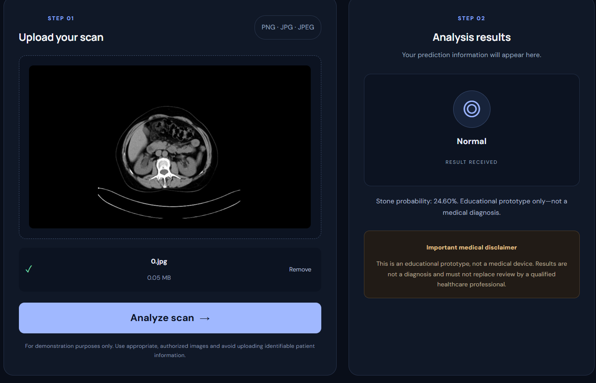
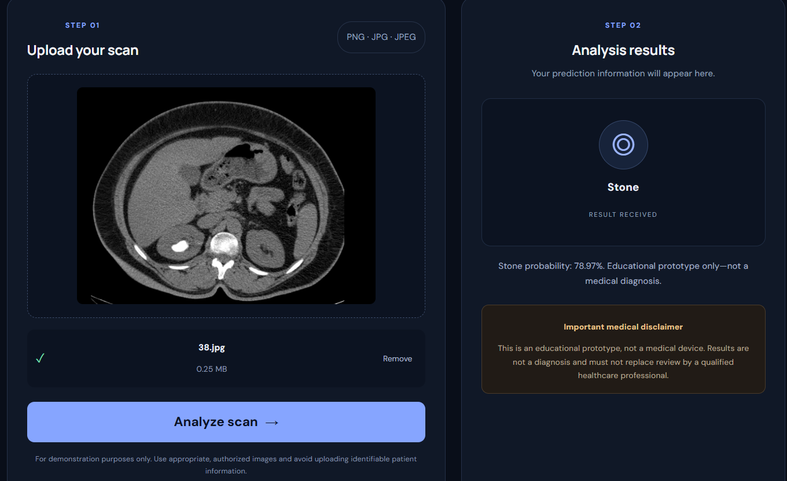

# Kidney Stone Detection Using Deep Learning

A deep learning web application that classifies kidney CT scan images into two categories: **Normal** and **Kidney Stone**. The project uses **PyTorch and MobileNetV2** for image classification, **FastAPI** for the backend API, and **React with Vite** for the frontend.

## Project Overview

This project explores medical image classification using transfer learning with a pretrained MobileNetV2 convolutional neural network. The trained model predicts whether an uploaded CT scan image belongs to the normal or kidney stone category.

The application provides a web interface where users can upload an image and view the model's prediction and confidence score.

The project includes a model training script, a prediction script, a trained model, a FastAPI backend, and a React frontend.

## Application Screenshots

### 1. Main Interface


### 2. Normal Prediction


### 3. Kidney Stone Prediction



## Features

- Classifies CT scan images into Normal and Kidney Stone categories.
- Uses MobileNetV2 transfer learning with PyTorch.
- Provides an interactive web interface for image upload and prediction.
- Uses FastAPI to serve predictions from the trained model.
- Displays the predicted class and confidence score.
- Includes a training script for model training and validation.

## Tech Stack

- **Programming Language:** Python, JavaScript
- **Deep Learning:** PyTorch, Torchvision
- **Model Architecture:** MobileNetV2
- **Image Processing:** Pillow, NumPy
- **Model Evaluation:** scikit-learn
- **Backend:** FastAPI, Uvicorn
- **Frontend:** React, Vite
- **Version Control:** Git, GitHub

## Project Structure

```text
kidney-stone-detection/
├── backend/
│   └── main.py
├── frontend/
│   ├── public/
│   ├── src/
│   │   ├── App.jsx
│   │   ├── App.css
│   │   ├── index.css
│   │   └── main.jsx
│   ├── package.json
│   └── vite.config.js
├── src/
│   ├── training.py
│   ├── predict.py
│   └── kidney_stone_model.pth
├── requirements.txt
├── .gitignore
└── README.md
```

## Dataset

The dataset is not included in this repository.

To train the model, organize your dataset using the following directory structure:

```text
Data/
└── train/
    ├── normal/
    └── stone/
```

Place the corresponding CT scan images in each category folder.

## Installation and Setup

### 1. Clone the Repository

```bash
git clone https://github.com/Shital-B-Simbarwal/Kidney-Stone-detection.git
cd Kidney-Stone-detection
```

### 2. Create and Activate a Virtual Environment

```powershell
python -m venv venv
.\venv\Scripts\Activate.ps1
```

### 3. Install Python Dependencies

```bash
pip install -r requirements.txt
```

### 4. Install Frontend Dependencies

Open a terminal in the frontend directory:

```bash
cd frontend
npm install
```

## Running the Application

The frontend and backend must run in separate terminals.

### Terminal 1: Start the Backend

From the project root, activate the virtual environment and run:

```bash
python -m uvicorn backend.main:app --reload
```

The backend API will be available at:

`http://127.0.0.1:8000`

Interactive API documentation is available at:

`http://127.0.0.1:8000/docs`

### Terminal 2: Start the Frontend

From the frontend directory, run:

```bash
npm run dev
```

Open the local URL printed by Vite, usually:

`http://localhost:5173`

Upload a supported CT scan image through the interface to view the model's prediction.

## Model Training

To train the model, first ensure the dataset is available in the expected directory structure. From the project root, run:

```bash
python src/training.py
```

The training script uses MobileNetV2 transfer learning and saves the trained model weights to:

`src/kidney_stone_model.pth`

Training requires the dataset and may take time depending on the hardware and configuration.

## Future Improvements

- Evaluate the model using a separate, held-out test dataset.
- Improve model generalization and validate confidence estimates.
- Add more comprehensive error handling and input validation.
- Improve the user interface and accessibility.
- Explore deployment options for a demonstration environment.

## Disclaimer

This project is intended for educational and research purposes only. It is not a clinically validated diagnostic tool. Predictions and confidence scores may be incorrect and must not be used for diagnosis, treatment, or other medical decisions.
